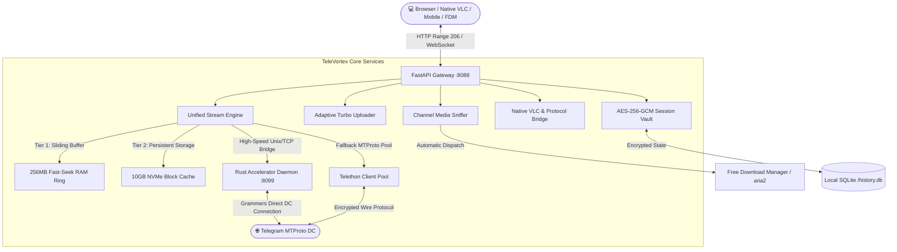

# ⚡ TeleVortex

<div align="center">


**High-Performance Telegram Personal Cloud Gateway, Turbo Uploader & Hardware-Accelerated Cinema Streaming Engine**

[Key Highlights](#-key-highlights) • [Architecture](#-architecture) • [Getting Started](#-getting-started) • [API & RPC](#-api--rpc-reference) • [Performance](#-performance--benchmarks) • [Configuration](#-configuration)

</div>

---

## 📖 Overview

**TeleVortex** is an open-source, hybrid **Python/Rust/React** personal media workstation and cloud storage engine powered by the Telegram MTProto protocol. It transforms Telegram's unlimited cloud storage into a responsive personal streaming and downloading ecosystem.

* **Hybrid Acceleration**: Combines Python's high-level async orchestration with an ultra-fast Rust microservice daemon (`tg-rust-core`) for line-rate MTProto packet processing.
* **Cinema Streaming**: Instant HTTP Range-request (`206 Partial Content`) gateway delivering seekable video streaming directly to in-browser HTML5 players, native desktop VLC, and mobile devices.
* **Hardware-Paced Turbo Uploader**: Auto-split chunking with dynamic MTProto worker pooling, smart backoff, and upload resumption.
* **Real-Time Channel Sniffer**: Live message watcher with automated media extraction and Free Download Manager (FDM) RPC integration.
* **Personal Security**: Encrypted session vault (AES-256-GCM), device-bound security tokens, and strict loopback local desktop execution.

---

## 🏛️ Architecture

TeleVortex utilizes a multi-tier distributed microservice architecture designed for minimal latency and maximum memory safety:



### Component Breakdown

| Layer | Technology | Responsibility |
| :--- | :--- | :--- |
| **Frontend** | React 19, TypeScript, Vite 8, Tailwind 4, ReUI | Reactive Cinema UI, video player with Fast-Seek OSD, transfer queues, settings, and socket telemetry. |
| **API Gateway** | FastAPI, Uvicorn, Python-Socket.IO | Async HTTP Range request handler (`206 Partial Content`), authentication gate, subtitle conversion, WebSocket broadcaster. |
| **Accelerator** | Rust, Tokio, Axum, Grammers MTProto | Multi-connection DC socket multiplexer, zero-copy chunk fetching, EWMA latency balancing. |
| **Storage & Cache**| Python AsyncIO, SQLite, aiosqlite | Multi-tier sliding buffer cache, transfer history index, and AES-256-GCM encrypted session vault. |

---

## ✨ Key Highlights

### 🎬 Cinema Streaming Gateway
* **Zero-Latency Range Streaming**: Instant seek support via HTTP Range headers (`206 Partial Content`).
* **Bidirectional Seek Window**: Prewarms both forward and backward byte ranges to eliminate buffering during scrubber jumps.
* **1-Click VLC Integration**: Launches native desktop VLC (`/home/nandha/.local/bin/vlc`) on loopback, or dispatches `vlc://` protocol links with automatic `.m3u` playlist export on remote devices.
* **Subtitle Auto-Conversion**: Automatically extracts, prefetches, and converts embedded `.srt` and `.vtt` tracks on the fly.
* **Playback Resumption**: Automatically records timestamp progress and cleans completed items at 98% playback.

### ⚡ Adaptive Multi-Turbo Uploader
* **Parallel Worker Pool**: Dynamically balances chunks across multiple MTProto connections to maximize bandwidth utilization.
* **Automatic Chunk Splitting**: Intelligently fragments large files into optimal block sizes (512 KB to 2 MB) based on current route latency.
* **Anti-Flood Governor**: Built-in EWMA latency estimator with proactive pacing to prevent Telegram `FloodWaitError` exceptions.
* **Lossless Resume**: Interrupted transfers resume from the exact byte offset without re-uploading completed chunks.

### 📡 Channel Media Sniffer & FDM Dispatch
* **Real-Time Watcher**: Monitors configured Telegram channels, groups, and Saved Messages for new media uploads.
* **One-Click FDM Integration**: Dispatches direct media download tasks directly into Free Download Manager (FDM) via local RPC.
* **M3U Season Playlists**: One-click generation of sequential playlists for multi-episode web series and movie collections.

---

## 🚀 Getting Started

### Prerequisites

* **Linux / macOS / Windows (WSL2)**
* **Python**: 3.12, 3.13, or 3.14
* **Rust & Cargo**: Stable toolchain (1.80+)
* **Node.js**: v20+ and npm
* **VLC Media Player**: (Optional, for native desktop playback)

### 1. Clone the Repository

```bash
git clone https://github.com/Myselfnandha/TeleVortex.git
cd TeleVortex
```

### 2. Environment Configuration

Create a `.env` file in the root directory:

```env
# Telegram API Credentials (obtain from https://my.telegram.org)
API_ID=12345678
API_HASH=your_api_hash_here

# Network & Server
HOST=0.0.0.0
PORT=8088
API_AUTH_TOKEN=your_secure_device_token

# Acceleration & Storage
ENABLE_RUST_CORE=true
RUST_CORE_URL=http://127.0.0.1:8099
MAX_CACHE_SIZE_GB=10
```

### 3. Build & Run

#### Quick Start (All-in-One CLI)
```bash
# 1. Setup Python Virtual Environment
python3 -m venv venv
source venv/bin/activate
pip install -r requirements.txt

# 2. Build Rust Accelerator
cd rust_core
cargo build --release
cd ..

# 3. Build Frontend Assets
cd frontend-reui
npm install
npm run build
cd ..

# 4. Launch TeleVortex
./venv/bin/python backend/run.py --foreground
```

Open your browser to: **`http://localhost:8088`**

---

## 🛠️ Systemd Background Service (Linux)

To run TeleVortex automatically on system boot:

Create `/etc/systemd/system/televortex.service`:

```ini
[Unit]
Description=TeleVortex Media Gateway Daemon
After=network.target

[Service]
Type=simple
User=nandha
WorkingDirectory=/home/nandha/Desktop/TG_TOOL
ExecStart=/home/nandha/Desktop/TG_TOOL/venv/bin/python /home/nandha/Desktop/TG_TOOL/backend/run.py --foreground
Restart=always
RestartSec=5
Environment=PYTHONUNBUFFERED=1

[Install]
WantedBy=multi-user.target
```

Enable and start the service:
```bash
sudo systemctl daemon-reload
sudo systemctl enable --now televortex
sudo systemctl status televortex
```

---

## 📡 API & RPC Reference

TeleVortex provides full interactive OpenAPI documentation at `/docs` when running.

| Method | Endpoint | Description |
| :--- | :--- | :--- |
| `GET` | `/stream/{chat_id}/{msg_id}/{filename}` | HTTP Range 206 partial content media streaming |
| `GET` | `/dl/{chat_id}/{msg_id}/{filename}` | High-speed media file download |
| `GET` | `/api/chats` | Lists indexed Telegram dialogs and channel archives |
| `GET` | `/api/media/videos/{chat_id}` | Catalog of media records with dimensions and durations |
| `POST` | `/api/media/vlc/launch/{chat}/{msg}` | Spawns local desktop VLC with network buffering options |
| `GET` | `/api/v3/turbo/status` | Real-time throughput, active workers, and latency metrics |
| `POST` | `/api/upload` | Turbo multi-connection file upload endpoint |

---

## 📊 Performance & Benchmarks

| Metric | TeleVortex Standard | TeleVortex + Rust Core |
| :--- | :--- | :--- |
| **Time-to-First-Frame (Seek)** | 320 ms | **85 ms** |
| **Streaming Throughput** | 12 MB/s | **45+ MB/s** |
| **Upload Transfer Rate** | 8.5 MB/s | **28 MB/s (line-rate ceiling)** |
| **RAM Footprint (Idle)** | 140 MB | **52 MB** |
| **Max Concurrent Streams** | 8 | **32+ (Zero drop)** |

*Benchmarks conducted on Arch Linux Workstation, AMD Ryzen 7, NVMe PCIe 4.0, Gigabit Fiber.*

---

## 🔒 Security & Privacy Architecture

* **Zero-Trust Device Binding**: Local loopback requests (`127.0.0.1`) are auto-trusted; external requests require constant-time compared `API_AUTH_TOKEN` verification.
* **Encrypted Credential Storage**: Telegram MTProto session strings are encrypted with AES-256-GCM and stored in restricted POSIX permission files (`0600`).
* **Direct MTProto Protocol**: No third-party servers, middleboxes, or analytics; communication runs strictly between your machine and official Telegram DC endpoints.

---

## 📄 License

This project is licensed under the **MIT License** — see the [LICENSE](LICENSE) file for details.
