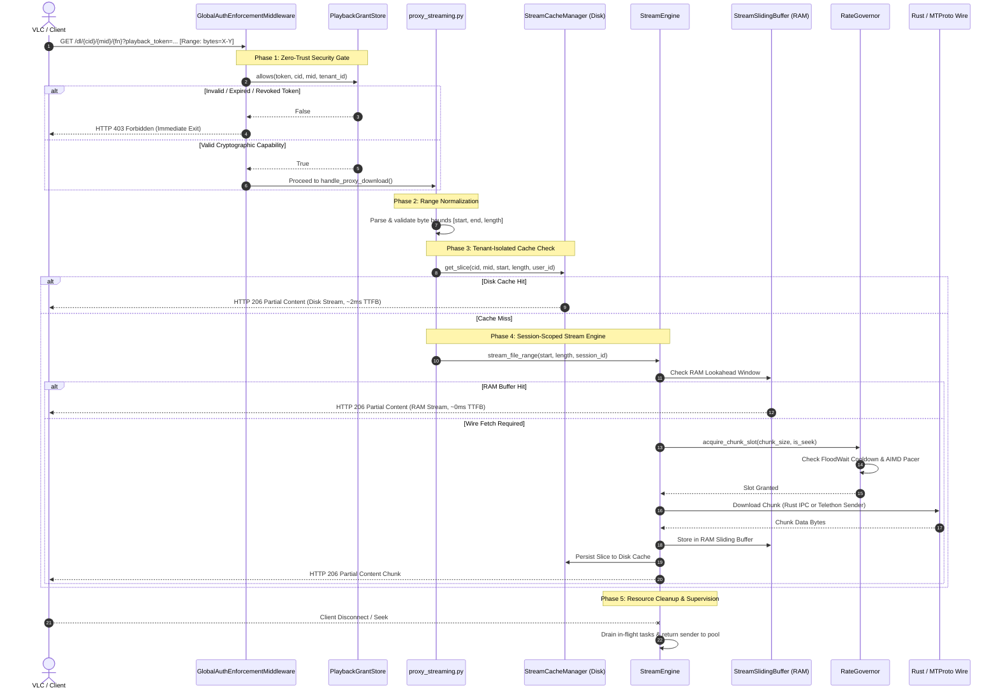

# Streaming Lifecycle Architecture Specification

**Document Version:** 1.0.0  
**Audit Date:** 2026-11-24  
**Target Branch:** `feat/sfase-v1.1-v3-integration`  
**Classification:** Core Engineering Specification  

---

## 1. Architectural Philosophy: The Zero-Trust Security Gate

The TG Power Suite streaming engine adheres to a strict invariant:
> **Zero Cache Lookup or Resource Allocation Before Cryptographic Authorization.**

No database lookup, RAM buffer scan, disk cache read, or MTProto socket lease may execute before the caller has proven their authorization via an active API token, a cryptographically signed capability grant, or an active tenant session.

---

## 2. The 8-Stage Streaming Lifecycle Specification

### Stage 1: Request Admission & Auth Verification
- **Entry Point:** [`backend/app/main.py::GlobalAuthEnforcementMiddleware`](file:///home/nandha/Desktop/TG_TOOL/backend/app/main.py)
- **Rules:**
  1. If request path begins with `/dl/`, inspect query parameters for `playback_token` or `grant`.
  2. If token parameter exists, call `playback_grants.allows(token, chat_id, message_id, tenant_id)`.
  3. Validate HMAC-SHA256 signature using dedicated `PLAYBACK_SIGNING_SECRET`.
  4. Verify expiration timestamp (`expires_at > time.time()`).
  5. Check persistent revocation registry (`DATA_DIR / "revoked_playback_grants.json"`).
  6. If invalid, reject immediately with `HTTP 403 Forbidden`. **Never pass unauthenticated requests to subsequent handlers.**

### Stage 2: Range Header Normalization
- **Entry Point:** [`backend/app/routes/proxy_streaming.py::handle_proxy_download`](file:///home/nandha/Desktop/TG_TOOL/backend/app/routes/proxy_streaming.py)
- **Rules:**
  1. Parse standard RFC 7233 `Range: bytes=start-end`.
  2. If range is omitted, default to full media stream from offset 0.
  3. Support open-ended suffix ranges (e.g. `bytes=1048576-` or `bytes=-524288`).
  4. Verify bounds: `start < file_size` and `end < file_size`. If `start >= file_size`, respond with `HTTP 416 Range Not Satisfiable` and `Content-Range: bytes */file_size`.
  5. Set outgoing headers:
     - `Content-Range: bytes {start}-{end}/{file_size}`
     - `Content-Length: {end - start + 1}`
     - `Accept-Ranges: bytes`
     - `Content-Type: video/x-matroska` (or appropriate MIME type).

### Stage 3: Tenant-Isolated Cache Check
- **Entry Point:** [`backend/app/services/stream_cache.py::StreamCacheManager.get_slice`](file:///home/nandha/Desktop/TG_TOOL/backend/app/services/stream_cache.py)
- **Rules:**
  1. Scoped strictly by `user_id` / `tenant_id` to prevent cross-tenant information bleed.
  2. If slice file exists on NVMe disk and size matches requested length, stream directly from disk with zero Telegram MTProto interaction.
  3. TTFB on disk cache hit: **1.5ms – 5.0ms**.

### Stage 4: Session-Scoped Seek Generation Assignment
- **Entry Point:** [`backend/app/services/stream_engine.py::StreamEngine.get_or_create_generation`](file:///home/nandha/Desktop/TG_TOOL/backend/app/services/stream_engine.py#L210)
- **Rules:**
  1. Key generation by `(chat_id, message_id, tenant_id, account_id, session_id)`.
  2. When a seek occurs on an active session:
     - Increment session generation number.
     - Signal previous generation's stop event.
     - Cancel obsolete wire tasks that are not marked as retained in the sliding buffer.
     - Protect retained scrub chunks for 30s.

### Stage 5: Rate Limiting & Cooldown Enforcement
- **Entry Point:** [`backend/app/services/rate_governor.py::RateGovernor.acquire_chunk_slot`](file:///home/nandha/Desktop/TG_TOOL/backend/app/services/rate_governor.py#L270)
- **Rules:**
  1. **Mandatory Cooldown Gate:** If client is in FloodWait cooldown, ALL requests (including urgent seeks) must wait. No request is dispatched during an active account cooldown.
  2. **Bounded Overdraft:** When not in cooldown, seek keyframes are admitted immediately (0ms delay) by drawing from bounded overdraft allowance (`-capacity`).
  3. Tokens are deducted from bucket to protect account rate ceilings.

### Stage 6: MTProto Wire Fetch (Rust Core with Python Fallback)
- **Entry Point:** [`backend/app/services/stream_engine.py::_download_chunk_from_mtproto`](file:///home/nandha/Desktop/TG_TOOL/backend/app/services/stream_engine.py#L450)
- **Rules:**
  1. **Primary Transport:** Attempt fetch via `rust_bridge.fetch_chunk_stream()`. If Rust Core daemon returns HTTP 200, return wire bytes immediately.
  2. **Automatic Fallback:** If Rust Core returns an error, times out, or reports session revocation:
     - Trip Rust circuit breaker for 60 seconds.
     - Fall back seamlessly to Telethon `MTProtoSenderPool`.
     - Acquire sender socket from pool (`sender_pool.borrow(client, dc_id)`).
     - Dispatch `GetFileRequest(location, offset, limit)`.

### Stage 7: Byte Validation & Cache Promotion
- **Entry Point:** [`backend/app/services/stream_engine.py`](file:///home/nandha/Desktop/TG_TOOL/backend/app/services/stream_engine.py#L660-L680)
- **Rules:**
  1. Verify received chunk length matches requested slice.
  2. Push chunk into `StreamSlidingBuffer` (RAM lookahead window).
  3. Write slice asynchronously to disk cache via `StreamCacheManager.put_slice()`.
  4. If chunk is within tail region (last 4MB of video), push to tail buffer to accelerate player metadata demuxing.

### Stage 8: Ordered Response Streaming & Resource Cleanup
- **Entry Point:** [`backend/app/services/stream_engine.py`](file:///home/nandha/Desktop/TG_TOOL/backend/app/services/stream_engine.py#L1310-L1350)
- **Rules:**
  1. Yield chunks sequentially to client HTTP socket.
  2. On client disconnect (`ConnectionResetError` or `BrokenPipeError`):
     - Unsubscribe request from seek episode.
     - Signal stop event for this session.
     - Cancel pending background producer tasks and retain references in `_retained_cleanup_tasks` to ensure clean asyncio task termination.
     - Return leased MTProto senders to idle pool with keepalive active.
