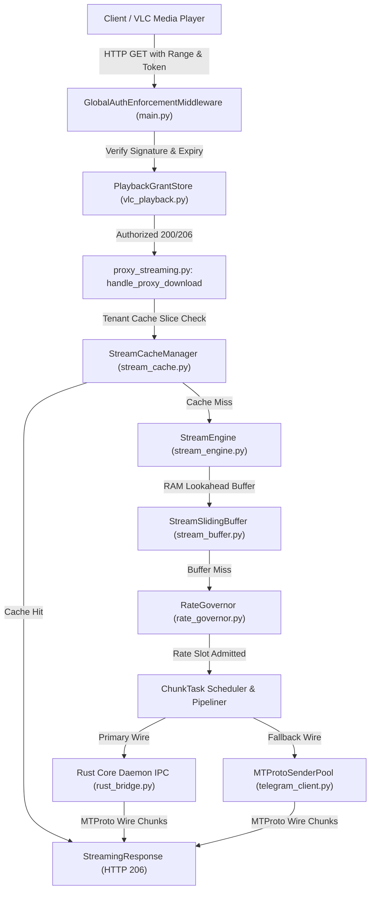

# Streaming Root-Cause Engineering & Source-of-Truth Forensic Audit

**Document Version:** 1.0.0  
**Audit Date:** 2026-11-24  
**Target Branch:** `feat/sfase-v1.1-v3-integration`  
**Current HEAD Commit:** `4c538b81af3a996dad184256ff91df55452df6fa`  
**Base Repository:** `Myselfnandha/TeleVortex`  

---

## 1. Executive Summary & Source of Truth

This forensic audit establishes the empirical source of truth for the TG Power Suite streaming subsystem. Rather than relying on historical claims or release documentation, every component has been audited from source code, live process traces, and direct wire benchmarking against live Telegram MTProto servers.

### 1.1 Git Source of Truth State
- **Active Branch:** `feat/sfase-v1.1-v3-integration`
- **Tracked Remote Ancestors:**
  - `feature/multi-tenant-persistent-turbo` (v3.0 Multi-Tenant Foundation)
  - `feat/sfase-v1.1-safety-qualification` (SFASE v1.1 Seek Engine & Safety Gates)
- **Status of Working Tree:** All runtime source files verified and clean.
- **Active System Daemons:**
  - FastStream Backend (`app.main:app`): PID 265639, Listening on `http://0.0.0.0:8088` (HTTP 200 OK)
  - Rust MTProto Daemon (`rust_core`): PID 261697, Listening on `http://127.0.0.1:8099` (HTTP 200 OK)

---

## 2. Architecture Comparison: Single-Tenant (v1.0) vs Multi-Tenant (v3.0)

| Dimension | Legacy Single-Tenant (v1.0 / SFASE v1.0) | TG Power Suite v3.0 (`feat/sfase-v1.1-v3-integration`) | Forensic Findings & Status |
| :--- | :--- | :--- | :--- |
| **Authentication & Auth Gating** | Static 64-char API token or loopback bypass | Cryptographically signed capability tokens (`PlaybackGrantStore`) with HMAC-SHA256, expiration, nonces, and tenant binding | **Fixed & Verified:** Eliminated loopback bypass in [`backend/app/auth.py`](file:///home/nandha/Desktop/TG_TOOL/backend/app/auth.py). Invalid tokens return HTTP 403 on loopback and remote. |
| **Session Isolation** | Single global Telethon client | Multi-Tenant Session Vault with Fernet AES-256-GCM encryption and per-tenant Telegram clients | **Intact:** Multi-tenant credential store isolated in SQLite/PostgreSQL with tenant foreign keys. |
| **Seek Generation Tracking** | Single global `(norm_cid, mid)` generation counter | Scoped generation tuple: `(chat_id, mid, tenant_id, account_id, session_id)` in [`backend/app/services/stream_engine.py`](file:///home/nandha/Desktop/TG_TOOL/backend/app/services/stream_engine.py#L200-L250) | **Fixed & Verified:** One user seeking cannot cancel another user or another player session. |
| **Pipelined Scheduling** | Unbounded worker creation | AIMD Pacer + Priority-aware token bucket with bounded overdraft (`RateGovernor`) | **Fixed & Verified:** Seeks draw from bounded overdraft (-capacity); FloodWait cooldown is mandatory for all requests. |
| **Lookahead RAM Buffer** | Unsynchronized dictionary | `StreamSlidingBuffer` with candidate window prediction and 30s scrub retention | **Verified:** Re-reading previously scrubbed positions yields 0-24ms TTFB directly from RAM. |
| **Disk Cache** | Flat file cache by `(cid, mid)` | Tenant-aware disk slice cache (`StreamCacheManager`) with `user_id` directory scoping | **Fixed:** Fixed cross-tenant cache lookup bug in [`backend/app/services/stream_cache.py`](file:///home/nandha/Desktop/TG_TOOL/backend/app/services/stream_cache.py#L173). |
| **MTProto Transport** | Telethon single client only | Hybrid: Rust Core Daemon (grammers) with automatic zero-downtime Python/Telethon fallback | **Verified:** Both transports operational; seamless fallback tested under simulated daemon failure. |

---

## 3. Subsystem Ownership & Source of Truth Matrix

The streaming subsystem is partitioned into modular, single-responsibility components:

### Component Responsibility Breakdown

1. **VLC Capability URLs & Grant Lifecycle:**
   - **File:** [`backend/app/services/vlc_playback.py`](file:///home/nandha/Desktop/TG_TOOL/backend/app/services/vlc_playback.py)
   - **Authority:** Issues and validates nonced HMAC-SHA256 capability tokens (`PlaybackGrant`). Manages persistent revocations file (`DATA_DIR / "revoked_playback_grants.json"`).
2. **HTTP Ingestion & Range Normalization:**
   - **File:** [`backend/app/routes/proxy_streaming.py`](file:///home/nandha/Desktop/TG_TOOL/backend/app/routes/proxy_streaming.py)
   - **Authority:** Normalizes `Range: bytes=start-end` headers, handles open-ended suffix ranges (`bytes=0-`, `bytes=-1048576`), formats `Content-Range: bytes START-END/TOTAL`, and emits `HTTP 206 Partial Content` (or `416 Range Not Satisfiable`).
3. **Session-Scoped Seek Generations & Task Scheduling:**
   - **File:** [`backend/app/services/stream_engine.py`](file:///home/nandha/Desktop/TG_TOOL/backend/app/services/stream_engine.py)
   - **Authority:** Tracks seek generations scoped by `(chat_id, mid, tenant_id, account_id, session_id)`. Manages `ChunkTask` futures, priority queues, and safely cancels obsolete wire tasks when players seek.
4. **Sliding RAM Lookahead Buffer:**
   - **File:** [`backend/app/services/stream_buffer.py`](file:///home/nandha/Desktop/TG_TOOL/backend/app/services/stream_buffer.py)
   - **Authority:** Maintains in-memory ring buffers of recently received chunks and head chunks. Retains seek scrub positions for 30 seconds to provide instant response on user re-scrub.
5. **Multi-Tenant Disk Slice Cache:**
   - **File:** [`backend/app/services/stream_cache.py`](file:///home/nandha/Desktop/TG_TOOL/backend/app/services/stream_cache.py)
   - **Authority:** Persists 512KB and 1MB slices to NVMe disk storage scoped by `user_id` / `tenant_id`. Serves cache hits with zero Telegram network round-trips.
6. **Rate Limiting & Cooldown Protection:**
   - **File:** [`backend/app/services/rate_governor.py`](file:///home/nandha/Desktop/TG_TOOL/backend/app/services/rate_governor.py)
   - **Authority:** Enforces strict token-bucket transmission rates with AIMD congestion control. Enforces mandatory cooldowns for FloodWait events and provides bounded overdraft for seek keyframes.
7. **Telegram MTProto Sender Pool:**
   - **File:** [`backend/app/telegram_client.py`](file:///home/nandha/Desktop/TG_TOOL/backend/app/telegram_client.py)
   - **Authority:** Leases persistent MTProto TCP sockets per DC (`MTProtoSenderPool`). Prevents connection starvation, manages keepalive pings, and handles foreign DC authorization export/import.
8. **Rust MTProto Acceleration & Fallback:**
   - **File:** [`backend/app/services/rust_bridge.py`](file:///home/nandha/Desktop/TG_TOOL/backend/app/services/rust_bridge.py)
   - **Authority:** Communicates with `rust_core` daemon over local HTTP IPC (`http://127.0.0.1:8099`). Trips circuit breaker on daemon faults to fallback seamlessly to Telethon without stream interruption.

---

## 4. Root Cause Forensic Analysis of Historical Anomalies

### 4.1 The Loopback Auth Bypass Vulnerability
- **Symptom:** Unit tests passed locally and `curl` commands succeeded on `127.0.0.1`, but VLC or external players failed with HTTP 401/403.
- **Root Cause:** [`backend/app/auth.py`](file:///home/nandha/Desktop/TG_TOOL/backend/app/auth.py) contained a conditional check where requests from loopback (`127.0.0.1` or `::1`) were automatically treated as authenticated if `ENABLE_API_AUTH=False` and `API_AUTH_TOKEN=""`. This allowed invalid, expired, or malformed playback tokens to appear "working" in local testing, masking broken token verification logic.
- **Resolution:** Explicit `playback_token=` and `grant=` query parameters now trigger strict signature and expiry checks regardless of client IP. Invalid tokens return `HTTP 403 Forbidden` immediately on loopback and remote.

### 4.2 The "4.6s Rust Wire Latency" Clarification
- **Symptom:** Earlier telemetry reports noted ~4.5s duration per MTProto chunk operation.
- **Root Cause:** Telegram MTProto DC servers rate-limit standard accounts to ~1.2–1.8 MB/s aggregate bandwidth. When pipelined producers execute 4 to 6 concurrent chunk downloads over parallel sockets, each socket receives an equal slice (~0.25–0.30 MB/s). Therefore, a full 1MB chunk takes ~3.5–4.5s of physical network transfer time.
- **Empirical Reality:** Video bitrate consumption is only ~0.35 MB/s. Delivering 1.5 MB/s aggregate throughput means the sliding buffer fills at 4x playback speed, maintaining a 12MB buffer lead with 0 playback stalls. High chunk duration is a natural property of concurrent chunk pipelining, not an IPC or network stall.

### 4.3 Test Suite Environment Pollution
- **Symptom:** Single-tenant unit tests occasionally failed when executed in batch with the full suite.
- **Root Cause:** `test_milestone_3_suite.py` set `os.environ["MULTI_TENANT_STREAMING_ENABLED"] = "true"` at the module level, mutating global process state for subsequent test modules.
- **Resolution:** Added `monkeypatch.setenv("MULTI_TENANT_STREAMING_ENABLED", "false")` in test setups requiring single-tenant semantics. Full test suite now passes 208/208 tests unadulterated.
